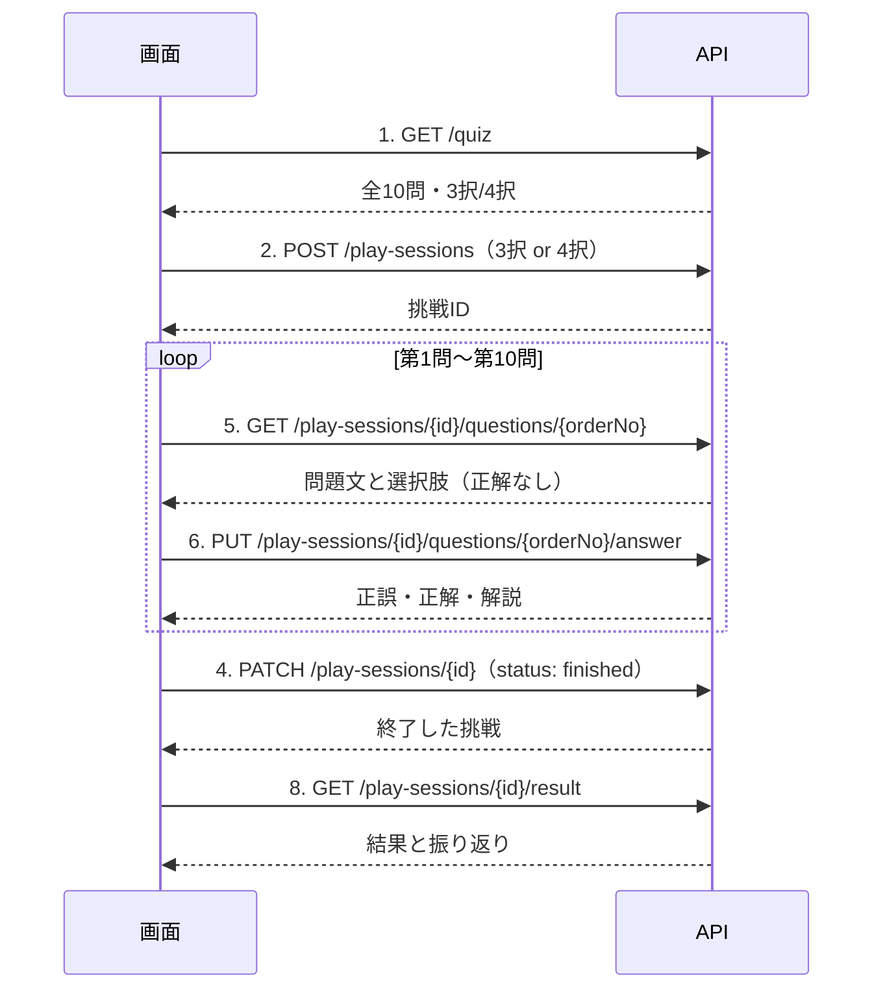

# API設計書

サッカークイズの画面から呼び出す Web API の設計書です。
データの構造は [db.md](db.md)（DB設計書）と [er.md](er.md)（ER図）を参照してください。

> 公開中の静的版（リポジトリ直下）は API も DB も使っていません。この API は Next.js 版（`api-server/`）が実装しています。
> この設計書は、DB設計書のテーブルを使ってクイズをサーバー側で動かす場合の API です。
> 今のアプリの機能（スタート／問題／結果の3画面）だけを対象にしています。

## 設計方針

アプリの要件（`CLAUDE.md` / `README.md`）から、API で守る方針を次のように決めています。

| 要件 | API での守り方 |
| --- | --- |
| 答えを先に言わない | 問題を取得する API は、正解・解説を返さない |
| 回答を待ってから正解と解説を言う | 正解・解説は「回答」リソースにだけ含め、回答を登録して初めて取得できる |
| 1問ずつ出す | まだ答えていない問題のうち、いちばん前の1問しか見られない・答えられない |
| 3択か4択かを選べる | 挑戦の開始時に択数を受け取り、その数だけ選択肢を返す |
| 出題順はシャッフル | 挑戦の開始時にサーバーが順番を決めて保存する |
| 解説に資料のどこに書いてあるかを添える | 解説には引用文と出典（資料名・章）を分けて返す |

## 共通仕様

### 基本

| 項目 | 内容 |
| --- | --- |
| ベースURL | `/api/v1` |
| 形式 | JSON（`Content-Type: application/json; charset=utf-8`） |
| 文字コード | UTF-8 |
| 認証 | メールアドレスとパスワードでログインし、Cookie でログイン状態を持つ（「認証とアクセス制御」を参照） |
| 日時 | ISO 8601 形式・タイムゾーン付き（例：`2026-09-29T21:00:00+09:00`） |

### URL の設計ルール

- URL は**リソース（名詞）**を表し、動詞を入れません。操作の種類は HTTP メソッドで表します。
- 複数あるリソース（コレクション）は**複数形**にします（`/play-sessions`, `/questions`）。
- 1つしか存在しないリソース（シングルトン）は**単数形**にします。
  - `/quiz` … このアプリのクイズ全体（1つだけ）
  - `/play-sessions/{playSessionId}/questions/{orderNo}/answer` … 1問に対する回答（1問に1つだけ）
  - `/play-sessions/{playSessionId}/result` … 1回の挑戦の結果（1つだけ）
- 単語の区切りはケバブケース（`play-sessions`）、パスパラメータはキャメルケース（`{playSessionId}`）です。
- 階層は「挑戦 → その挑戦の n 問目 → その回答」の親子関係だけで、3階層までにします。

### リソースの構造

```
/quiz                                                     クイズ全体
/play-sessions                                            挑戦の一覧（作成のみ）
/play-sessions/{playSessionId}                            1回の挑戦
/play-sessions/{playSessionId}/result                     その挑戦の結果
/play-sessions/{playSessionId}/questions/{orderNo}        その挑戦の n 問目
/play-sessions/{playSessionId}/questions/{orderNo}/answer その問題への回答
```

`questions/{orderNo}` は、問題そのもの（DB の `questions`）ではなく、**その挑戦で n 番目に出す問題**を表します（DB の `session_answers` の1行）。
問題の DB 上の ID は外に出しません。

### JSON の命名規則

| 対象 | 規則 | 例 |
| --- | --- | --- |
| プロパティ名 | キャメルケース | `choiceCount`, `orderNo` |
| 真偽値 | `is` で始める | `isCorrect` |
| 日時 | `At` で終わる | `finishedAt` |
| 番号・順番 | `No` で終わる | `orderNo`, `choiceNo` |
| 件数 | `Total` / `Count` で終わる | `questionTotal`, `answeredCount` |
| 状態などの決まった値 | キャメルケースの文字列 | `"inProgress"`, `"finished"` |
| エラーコード | 大文字のスネークケース | `ALREADY_ANSWERED` |

画面側の `script.js` もキャメルケース（`choiceCount` など）なので、そのまま使えます。
DB のカラム名（スネークケース）との変換はサーバー側で行います。

### 外に出さない値

| 値 | 理由 | 代わりに返すもの |
| --- | --- | --- |
| `play_sessions.id`（連番） | 推測されると他人の挑戦を操作できる | `play_sessions.public_id`（UUID） |
| `questions.id` / `choices.id` | DB の内部の値で、画面には不要 | 出題順 `orderNo`、選択肢の番号 `choiceNo` |
| `choices.is_correct`（回答前） | 答えが先に分かってしまう | 回答後に「回答」リソースでだけ返す |
| `questions.deleted_at` などの管理用の値 | 画面には不要 | 返さない |
| エラーの詳しい内容（SQL、スタックトレース） | 内部構造が分かってしまう | エラーコードと利用者向けのメッセージだけ返し、詳細はサーバーのログに残す |

### 共通のリクエストヘッダー

| ヘッダー | 必須 | 説明 |
| --- | --- | --- |
| `Content-Type: application/json` | 本文があるとき | それ以外は `415` |
| `Accept: application/json` | 任意 | |
| `X-Request-Id` | 任意 | 画面側で付けた問い合わせ用のID。なければサーバーが作る |

### 共通のレスポンスヘッダー

| ヘッダー | 説明 |
| --- | --- |
| `X-Request-Id` | この要求のID。エラー本文の `requestId` と同じ値。問い合わせやログ調査に使う |
| `Cache-Control` | `/quiz` は `public, max-age=60`、それ以外は `no-store`（回答や結果をキャッシュに残さない） |

## ステータスコード

| コード | 意味 | 使う場面 |
| --- | --- | --- |
| `200 OK` | 成功 | 取得、挑戦の終了、同じ回答の再送 |
| `201 Created` | 作成した | 挑戦の開始、回答の登録（初回） |
| `400 Bad Request` | リクエストの形がおかしい | JSON が壊れている、必須項目がない、型が違う、パスの `orderNo` が整数でない |
| `401 Unauthorized` | ログインしていない | 2〜8 をログインせずに呼んだ、ログインの有効期限が切れた |
| `404 Not Found` | 見つからない | 存在しない挑戦ID・出題順、まだ回答していない問題の回答 |
| `405 Method Not Allowed` | そのメソッドは使えない | 例：`DELETE /play-sessions/{playSessionId}`。`Allow` ヘッダーで使えるメソッドを返す |
| `409 Conflict` | 今の状態ではできない | 回答済みの問題に別の答えを送った、順番を飛ばした、未回答が残っている、登録済みのメールアドレス |
| `415 Unsupported Media Type` | 本文が JSON でない | `Content-Type` が `application/json` 以外 |
| `422 Unprocessable Entity` | 形は正しいが値がルールに合わない | 択数が3・4以外、3択なのに D を選んだ、メールアドレスの形式が違う、パスワードが短い |
| `429 Too Many Requests` | 呼び出しが多すぎる | 「呼び出し回数の制限」を超えた。`Retry-After` ヘッダーを付ける |
| `500 Internal Server Error` | サーバーの不具合 | 想定外のエラー |
| `503 Service Unavailable` | 一時的に使えない | メンテナンス中、DB に接続できない。`Retry-After` ヘッダーを付ける |

**使わないステータスコード**

| コード | 使わない理由 |
| --- | --- |
| `204 No Content` | 本文を返さない API がないため。挑戦の終了（`PATCH`）も、画面が状態を確認できるよう本文を返す。例外として、CORS のプリフライト（`OPTIONS`）にだけは `204` で答える |
| `403 Forbidden` | 他人の挑戦を指定されたときも `404` にするため。`403` を返すと「その ID の挑戦が存在する」ことが分かってしまう（「認証とアクセス制御」） |

`400` と `422` の使い分け：JSON として読めない・型が違うなど「形」の誤りは `400`、形は正しいが値がルールに合わないものは `422` です。

## エラーの共通フォーマット

エラーのときは、どの API でも次の形で返します。

```json
{
  "error": {
    "code": "INVALID_REQUEST",
    "message": "リクエストの内容に誤りがあります。",
    "details": [
      { "field": "choiceNo", "reason": "整数で指定してください。" }
    ],
    "requestId": "8f14e45f-ceea-467a-9575-7e5b5a3c4a1d"
  }
}
```

| キー | 型 | 必ずある | 説明 |
| --- | --- | --- | --- |
| `error.code` | string | ○ | エラーの種類（下の表）。画面側の処理の分岐にはこれを使う |
| `error.message` | string | ○ | 利用者向けの日本語メッセージ。文言は変わることがあるので、処理の分岐には使わない |
| `error.details` | object[] | | 項目ごとの誤り（`400` / `422` のとき） |
| `error.details[].field` | string | | 誤りのある項目名（JSON のプロパティ名） |
| `error.details[].reason` | string | | 誤りの内容 |
| `error.requestId` | string | ○ | `X-Request-Id` ヘッダーと同じ値 |

| `code` | ステータス | 意味 |
| --- | --- | --- |
| `INVALID_REQUEST` | 400 | リクエストの形がおかしい |
| `UNAUTHORIZED` | 401 | ログインしていない |
| `NOT_FOUND` | 404 | `/api/v1` の下の、どの API にも当たらない URL |
| `PLAY_SESSION_NOT_FOUND` | 404 | 挑戦が見つからない |
| `QUESTION_NOT_FOUND` | 404 | その出題順の問題がない |
| `ANSWER_NOT_FOUND` | 404 | まだ回答していない |
| `METHOD_NOT_ALLOWED` | 405 | そのメソッドは使えない |
| `QUESTION_LOCKED` | 409 | 前の問題に答えていないので、まだ見られない・答えられない |
| `ALREADY_ANSWERED` | 409 | すでに別の選択肢で回答済み |
| `ALREADY_FINISHED` | 409 | 終了済みの挑戦には回答できない |
| `UNANSWERED_QUESTIONS` | 409 | 未回答の問題が残っているので終了できない |
| `NOT_FINISHED` | 409 | まだ終了していないので結果を見られない |
| `NO_QUESTIONS` | 409 | 出題できる問題が1問もない |
| `EMAIL_TAKEN` | 409 | そのメールアドレスはすでに登録されている |
| `UNSUPPORTED_MEDIA_TYPE` | 415 | 本文が JSON でない |
| `INVALID_CHOICE_COUNT` | 422 | 択数が3・4以外 |
| `CHOICE_OUT_OF_RANGE` | 422 | 択数を超える選択肢を選んだ（3択で D など） |
| `INVALID_STATUS` | 422 | 挑戦の状態を `"finished"` 以外に変えようとした |
| `INVALID_EMAIL` | 422 | メールアドレスの形式が正しくない |
| `WEAK_PASSWORD` | 422 | パスワードが短すぎる・長すぎる |
| `RATE_LIMITED` | 429 | 呼び出しが多すぎる |
| `INTERNAL_ERROR` | 500 | サーバーの不具合 |
| `SERVICE_UNAVAILABLE` | 503 | 一時的に使えない |

## API一覧

| # | メソッド | パス | 概要 | 成功時 |
| --- | --- | --- | --- | --- |
| 1 | `GET` | `/quiz` | クイズ全体の情報（問題数・択数）を取得 | 200 |
| 2 | `POST` | `/play-sessions` | 挑戦を開始する | 201 |
| 3 | `GET` | `/play-sessions/{playSessionId}` | 挑戦の状態を取得 | 200 |
| 4 | `PATCH` | `/play-sessions/{playSessionId}` | 挑戦を終了する | 200 |
| 5 | `GET` | `/play-sessions/{playSessionId}/questions/{orderNo}` | n 問目を取得（正解・解説なし） | 200 |
| 6 | `PUT` | `/play-sessions/{playSessionId}/questions/{orderNo}/answer` | 回答を登録し、正解・解説を受け取る | 201 / 200 |
| 7 | `GET` | `/play-sessions/{playSessionId}/questions/{orderNo}/answer` | 登録済みの回答を取得 | 200 |
| 8 | `GET` | `/play-sessions/{playSessionId}/result` | 結果と振り返りを取得 | 200 |
| 9 | `POST` | `/users` | 利用者を登録する | 201 |

- 1 と 9 はログインなしで呼べます。2〜8 はログインが必要で、ログインしていなければ `401 UNAUTHORIZED` を返します（各 API の「エラー」の表では省略）。
- ログイン・ログアウトは `/api/v1` ではなく、next-auth が用意する `/api/auth/*` で行います（「認証とアクセス制御」）。

### HTTPメソッドの使い分け

| メソッド | 使う場面 | 理由 |
| --- | --- | --- |
| `GET` | 取得（1, 3, 5, 7, 8） | 状態を変えない |
| `POST` | 挑戦の開始（2）、利用者の登録（9） | 新しいものを作り、ID はサーバーが決める |
| `PATCH` | 挑戦の終了（4） | 挑戦の一部（状態）だけを変える |
| `PUT` | 回答の登録（6） | 1問に1つの回答を、URL で場所を決めて置く。同じ内容を何度送っても結果が同じ（べき等） |
| `DELETE` | 使わない | 挑戦や回答を消す機能はない。途中でやめた挑戦は未完了のまま残す（[db.md](db.md) の「論理削除」） |

### 画面の流れ



---

## 1. クイズ全体の情報を取得する

`GET /api/v1/quiz`

スタート画面の「全10問」の表示と、選べる択数に使います。

### レスポンス `200 OK`

```json
{
  "questionTotal": 10,
  "choiceCounts": [3, 4]
}
```

| キー | 型 | 説明 |
| --- | --- | --- |
| `questionTotal` | integer | 出題中の問題数 |
| `choiceCounts` | integer[] | 選べる択数 |

### エラー

共通のエラー（`429` / `500` / `503`）のみ。

### DB

- `questions` のうち `deleted_at IS NULL` の件数を数えます。

---

## 2. 挑戦を開始する

`POST /api/v1/play-sessions`

スタートボタンと「もう一度挑戦する」ボタンで呼びます。出題順はサーバーがシャッフルして決めます。

### リクエスト

```json
{
  "choiceCount": 3
}
```

| キー | 型 | 必須 | 説明 |
| --- | --- | --- | --- |
| `choiceCount` | integer | ○ | 択数（`3` または `4`） |

### レスポンス `201 Created`

`Location: /api/v1/play-sessions/2d853023-076e-4aa8-a92e-e837bce839f6`

本文は「挑戦」の形（API 3 と同じ）です。

```json
{
  "id": "2d853023-076e-4aa8-a92e-e837bce839f6",
  "choiceCount": 3,
  "questionTotal": 10,
  "answeredCount": 0,
  "nextOrderNo": 1,
  "status": "inProgress",
  "createdAt": "2026-09-29T21:00:00+09:00",
  "finishedAt": null
}
```

### エラー

| ステータス | `code` | 条件 |
| --- | --- | --- |
| 400 | `INVALID_REQUEST` | `choiceCount` がない、整数でない |
| 422 | `INVALID_CHOICE_COUNT` | `choiceCount` が3・4以外 |
| 409 | `NO_QUESTIONS` | 出題中の問題が0件 |

### DB

1つのトランザクションで次を行います。

1. `play_sessions` に1行追加する（`choice_count`）。`public_id` は DB が作ります。
2. `deleted_at IS NULL` の問題をシャッフルし、`session_answers` に全問ぶん追加する（`order_no` = 1, 2, …、`selected_choice_id` は `NULL`）。

---

## 3. 挑戦の状態を取得する

`GET /api/v1/play-sessions/{playSessionId}`

ページを再読み込みしたときなどに、どこまで進んだかを確認するために使います。

### パスパラメータ

| 名前 | 型 | 説明 |
| --- | --- | --- |
| `playSessionId` | string（UUID） | 挑戦ID |

### レスポンス `200 OK`

```json
{
  "id": "2d853023-076e-4aa8-a92e-e837bce839f6",
  "choiceCount": 3,
  "questionTotal": 10,
  "answeredCount": 4,
  "nextOrderNo": 5,
  "status": "inProgress",
  "createdAt": "2026-09-29T21:00:00+09:00",
  "finishedAt": null
}
```

| キー | 型 | 説明 |
| --- | --- | --- |
| `id` | string | 挑戦ID（UUID） |
| `choiceCount` | integer | 択数 |
| `questionTotal` | integer | この挑戦の問題数 |
| `answeredCount` | integer | 回答済みの問題数 |
| `nextOrderNo` | integer \| null | 次に答える問題の出題順（全問回答済みなら `null`） |
| `status` | string | `"inProgress"`（挑戦中）または `"finished"`（終了） |
| `createdAt` | string | 開始日時 |
| `finishedAt` | string \| null | 終了日時 |

### エラー

| ステータス | `code` | 条件 |
| --- | --- | --- |
| 404 | `PLAY_SESSION_NOT_FOUND` | 挑戦がない（UUID の形でない場合も含む） |

### DB

- `play_sessions` を `public_id` で取得し、`session_answers` の件数・回答済み件数（`selected_choice_id IS NOT NULL`）を数えます。
- `status` は `finished_at` が `NULL` かどうかから決めます（DB に状態の列は持ちません）。

---

## 4. 挑戦を終了する

`PATCH /api/v1/play-sessions/{playSessionId}`

最後の問題の「結果を見る」ボタンで呼びます。変えられるのは `status` を `"finished"` にすることだけです。

### リクエスト

```json
{
  "status": "finished"
}
```

| キー | 型 | 必須 | 説明 |
| --- | --- | --- | --- |
| `status` | string | ○ | `"finished"` のみ指定できる |

### レスポンス `200 OK`

終了後の「挑戦」（API 3 と同じ形）を返します。すでに終了済みの挑戦に送っても、同じ内容を `200` で返します（べき等）。

### エラー

| ステータス | `code` | 条件 |
| --- | --- | --- |
| 400 | `INVALID_REQUEST` | `status` がない、文字列でない、`status` 以外の項目がある |
| 404 | `PLAY_SESSION_NOT_FOUND` | 挑戦がない |
| 409 | `UNANSWERED_QUESTIONS` | 未回答の問題が残っている |
| 422 | `INVALID_STATUS` | `status` が `"finished"` 以外（終了した挑戦を再開することもできない） |

### DB

- 未回答の `session_answers` がないことを確認し、`play_sessions.finished_at` が `NULL` のときだけ `now()` を記録します。

---

## 5. n 問目を取得する

`GET /api/v1/play-sessions/{playSessionId}/questions/{orderNo}`

問題画面に表示する問題文と選択肢を返します。**正解・解説は含めません。**

### パスパラメータ

| 名前 | 型 | 説明 |
| --- | --- | --- |
| `playSessionId` | string（UUID） | 挑戦ID |
| `orderNo` | integer | 出題順（1〜`questionTotal`） |

### レスポンス `200 OK`

```json
{
  "orderNo": 1,
  "questionTotal": 10,
  "body": "サッカーの1チームの人数は何人ですか？",
  "choices": [
    { "choiceNo": 1, "label": "A", "body": "10人" },
    { "choiceNo": 2, "label": "B", "body": "11人" },
    { "choiceNo": 3, "label": "C", "body": "12人" }
  ],
  "isAnswered": false
}
```

| キー | 型 | 説明 |
| --- | --- | --- |
| `orderNo` | integer | 出題順（「第1問 / 全10問」の表示に使う） |
| `questionTotal` | integer | 問題数 |
| `body` | string | 問題文 |
| `choices` | object[] | 選択肢（`choiceNo` が択数以下のものだけ、`choiceNo` の順）。最大4件なのでページングしない |
| `choices[].choiceNo` | integer | 選択肢の番号（1〜4） |
| `choices[].label` | string | 表示用の記号（`A`〜`D`） |
| `choices[].body` | string | 選択肢の文言 |
| `isAnswered` | boolean | 回答済みか。`true` なら API 7 で正解・解説を取得できる |

### エラー

| ステータス | `code` | 条件 |
| --- | --- | --- |
| 400 | `INVALID_REQUEST` | `orderNo` が整数でない |
| 404 | `PLAY_SESSION_NOT_FOUND` | 挑戦がない |
| 404 | `QUESTION_NOT_FOUND` | その出題順がない |
| 409 | `QUESTION_LOCKED` | 前の問題が未回答（`orderNo` が次に答える問題より後） |

### DB

- `session_answers`（主キー `play_session_id`, `order_no`）から `question_id` を取り、`questions.body` を取得します。
- `choices` を `question_id = ? AND choice_no <= choice_count ORDER BY choice_no` で取得します。

---

## 6. 回答を登録する

`PUT /api/v1/play-sessions/{playSessionId}/questions/{orderNo}/answer`

選んだ選択肢を送ると、正誤・正解・解説が返ります。1問に登録できる回答は1つだけです。

### リクエスト

```json
{
  "choiceNo": 2
}
```

| キー | 型 | 必須 | 説明 |
| --- | --- | --- | --- |
| `choiceNo` | integer | ○ | 選んだ選択肢の番号（1〜択数） |

### レスポンス `201 Created`（初めて回答したとき）

`Location: /api/v1/play-sessions/2d853023-076e-4aa8-a92e-e837bce839f6/questions/1/answer`

```json
{
  "orderNo": 1,
  "isCorrect": true,
  "selectedChoice": { "choiceNo": 2, "label": "B", "body": "11人" },
  "correctChoice": { "choiceNo": 2, "label": "B", "body": "11人" },
  "explanation": {
    "quote": "サッカーは基本的に1チーム11人で試合をします。",
    "source": {
      "fileName": "soccer_knowledge.md",
      "sectionNo": 1,
      "sectionTitle": "サッカーの基本ルール"
    },
    "text": "「サッカーは基本的に1チーム11人で試合をします。」（soccer_knowledge.md 「1. サッカーの基本ルール」より）"
  },
  "answeredAt": "2026-09-29T21:00:15+09:00",
  "nextOrderNo": 2
}
```

| キー | 型 | 説明 |
| --- | --- | --- |
| `orderNo` | integer | 出題順 |
| `isCorrect` | boolean | 正解したか（`choices.is_correct` から求める） |
| `selectedChoice` | object | 選んだ選択肢 |
| `correctChoice` | object | 正解の選択肢 |
| `explanation.quote` | string | 資料からの引用文 |
| `explanation.source` | object | 出典（資料のファイル名・章番号・章の見出し）。利用者に出典を示すための値 |
| `explanation.text` | string | 画面にそのまま出せる解説文 |
| `answeredAt` | string | 回答日時 |
| `nextOrderNo` | integer \| null | 次の問題の出題順。最後の問題なら `null`（画面は「結果を見る」ボタンを出す） |

### レスポンス `200 OK`（同じ回答を再送したとき）

すでに**同じ `choiceNo`** で回答済みなら、登録済みの回答を `200` で返します。通信が切れて再送した場合も、結果は変わりません（べき等）。
**別の `choiceNo`** を送った場合は `409 ALREADY_ANSWERED` です（答えは変えられません）。

### エラー

| ステータス | `code` | 条件 |
| --- | --- | --- |
| 400 | `INVALID_REQUEST` | `choiceNo` がない、整数でない |
| 404 | `PLAY_SESSION_NOT_FOUND` | 挑戦がない |
| 404 | `QUESTION_NOT_FOUND` | その出題順がない |
| 409 | `ALREADY_FINISHED` | 挑戦が終了済み |
| 409 | `ALREADY_ANSWERED` | 別の選択肢で回答済み |
| 409 | `QUESTION_LOCKED` | 前の問題が未回答 |
| 422 | `CHOICE_OUT_OF_RANGE` | `choiceNo` が1〜択数の範囲外 |

### DB

1. `choiceNo` から `choices.id` を求めます（`question_id` と `choice_no` の一意制約を使う）。
2. 次の条件つきで `session_answers` を更新します。

   ```sql
   UPDATE session_answers
   SET selected_choice_id = $1, answered_at = now()
   WHERE play_session_id = $2 AND order_no = $3
     AND selected_choice_id IS NULL;
   ```

   更新件数が0件なら回答済みです。登録済みの選択肢が同じなら `200`、違えば `409` を返します。ボタンの二度押しや同時送信があっても、最初の1回だけが記録されます。
3. 解説は `questions` → `source_sections` → `sources` をたどって組み立てます。

3択で D を選ぶ・別の問題の選択肢を選ぶといった不正は、DB の制約でも止まります（[db.md](db.md) の「DB で保証するルール」）。API では、その前に分かりやすいエラーを返します。

---

## 7. 登録済みの回答を取得する

`GET /api/v1/play-sessions/{playSessionId}/questions/{orderNo}/answer`

回答した直後にページを再読み込みしたとき、正解・解説を表示し直すために使います。

### レスポンス `200 OK`

API 6 のレスポンスと同じ形です。

### エラー

| ステータス | `code` | 条件 |
| --- | --- | --- |
| 400 | `INVALID_REQUEST` | `orderNo` が整数でない |
| 404 | `PLAY_SESSION_NOT_FOUND` | 挑戦がない |
| 404 | `QUESTION_NOT_FOUND` | その出題順がない |
| 404 | `ANSWER_NOT_FOUND` | まだ回答していない（回答前に正解を見ることはできない） |

---

## 8. 結果を取得する

`GET /api/v1/play-sessions/{playSessionId}/result`

結果画面の正解数・正答率・振り返りを返します。

### レスポンス `200 OK`

```json
{
  "playSessionId": "2d853023-076e-4aa8-a92e-e837bce839f6",
  "choiceCount": 3,
  "score": 8,
  "questionTotal": 10,
  "correctRate": 80,
  "finishedAt": "2026-09-29T21:03:00+09:00",
  "reviews": [
    {
      "orderNo": 1,
      "questionBody": "サッカーの1チームの人数は何人ですか？",
      "isCorrect": true,
      "selectedChoice": { "choiceNo": 2, "label": "B", "body": "11人" },
      "correctChoice": { "choiceNo": 2, "label": "B", "body": "11人" }
    },
    {
      "orderNo": 2,
      "questionBody": "2002年大会は日本とどこの国が共同開催しましたか？",
      "isCorrect": false,
      "selectedChoice": { "choiceNo": 1, "label": "A", "body": "中国" },
      "correctChoice": { "choiceNo": 2, "label": "B", "body": "韓国" }
    }
  ]
}
```

| キー | 型 | 説明 |
| --- | --- | --- |
| `playSessionId` | string | 挑戦ID（UUID） |
| `choiceCount` | integer | 択数 |
| `score` | integer | 正解数 |
| `questionTotal` | integer | 問題数 |
| `correctRate` | integer | 正答率（%、四捨五入） |
| `finishedAt` | string | 終了日時 |
| `reviews` | object[] | 振り返り（`orderNo` の順）。件数は問題数と同じ（今は10件）なのでページングしない |
| `reviews[].questionBody` | string | 問題文 |
| `reviews[].isCorrect` | boolean | 正解したか |
| `reviews[].selectedChoice` | object | 選んだ選択肢 |
| `reviews[].correctChoice` | object | 正解の選択肢 |

### エラー

| ステータス | `code` | 条件 |
| --- | --- | --- |
| 404 | `PLAY_SESSION_NOT_FOUND` | 挑戦がない |
| 409 | `NOT_FINISHED` | まだ終了していない |

### DB

- `score` / `isCorrect` / `correctRate` は保存せず、その都度集計します（[db.md](db.md) の「正規化とデータ整合性」）。

  ```sql
  SELECT a.order_no, q.body, c.choice_no, c.body, c.is_correct
  FROM session_answers a
  JOIN questions q ON q.id = a.question_id
  JOIN choices   c ON c.id = a.selected_choice_id
  WHERE a.play_session_id = $1
  ORDER BY a.order_no;
  ```

  正解の選択肢は `choices` を `question_id` と `is_correct = true` で取得します。

---

## 9. 利用者を登録する

`POST /api/v1/users`

新規登録画面から呼びます。ログインは不要です。登録したあと、画面は続けて next-auth でログインします。

### リクエスト

```json
{ "email": "taro@example.com", "password": "correct-horse-battery" }
```

| キー | 型 | 必須 | 説明 |
| --- | --- | --- | --- |
| `email` | string | ○ | メールアドレス。前後の空白を除き、小文字にそろえて保存する |
| `password` | string | ○ | パスワード（8〜128文字） |

決められた項目以外が入っていたら `400` です。

### レスポンス `201 Created`

```json
{ "email": "taro@example.com", "createdAt": "2026-10-20T19:00:00+09:00" }
```

利用者の DB 上の ID とパスワードは返しません。

### エラー

| ステータス | `code` | 条件 |
| --- | --- | --- |
| 400 | `INVALID_REQUEST` | `email` / `password` がない、文字列でない、決められた項目以外がある |
| 409 | `EMAIL_TAKEN` | そのメールアドレスはすでに登録されている（大文字・小文字の違いは同じとみなす） |
| 422 | `INVALID_EMAIL` | メールアドレスの形式が正しくない |
| 422 | `WEAK_PASSWORD` | パスワードが8文字未満、または128文字より長い |

### DB

- `users` に1行作ります。パスワードはそのまま保存せず、scrypt でハッシュ化した値だけを `password_hash` に保存します（[db.md](db.md) の「7. users」）。

---

## 画面との対応

| 画面 | 操作 | 呼ぶ API |
| --- | --- | --- |
| どこでも | ログインしていない | ログイン画面（`/login`）へ移る |
| 新規登録 | 「登録してはじめる」 | 9. `POST /users` → next-auth でログイン |
| ログイン | 「ログイン」 | next-auth でログイン（`POST /api/auth/callback/credentials`） |
| どこでも | 「ログアウト」 | next-auth でログアウト（`POST /api/auth/signout`） |
| どこでも | API が `401` を返した | ログイン画面へ移る |
| スタート | 表示 | 1. `GET /quiz` |
| スタート | 3択／4択を選んで「スタート」 | 2. `POST /play-sessions` → 5. 第1問を取得 |
| 問題 | 選択肢をクリック（または 1〜4 キー） | 6. `PUT .../answer` |
| 問題 | 「次の問題へ」 | 5. 次の問題を取得（`nextOrderNo`） |
| 問題 | 「結果を見る」 | 4. `PATCH /play-sessions/{id}` → 8. `GET .../result` |
| 結果 | 「もう一度挑戦する」 | 2. `POST /play-sessions`（同じ `choiceCount`） |
| どこでも | 再読み込み | 3. `GET /play-sessions/{id}` で状態を確認 → 5・7・8 のどれか |

挑戦IDは、画面側で `sessionStorage` に保存しておくと、再読み込みしても続きから再開できます。

## 非機能要件・運用

### 認証とアクセス制御

**認証（だれか）**

- メールアドレスとパスワードでログインします。仕組みには [next-auth](https://next-auth.js.org/)（v4）の Credentials プロバイダーを使います。
- ログインに成功すると、利用者の ID とメールアドレスを入れた JWT を、署名・暗号化して Cookie（`next-auth.session-token`、本番の https では `__Secure-next-auth.session-token`）に入れます。`HttpOnly` なので画面の JavaScript からは読めません。
- 鍵は環境変数 `NEXTAUTH_SECRET` です。ログイン状態は DB に保存しません。有効期間は最後に使ってから7日です。
- パスワードは scrypt（ソルト付き）でハッシュ化して保存し、照合は一定時間で比較します。登録されていないメールアドレスでも同じだけ時間をかけ、どちらが違うかも返しません（登録済みかどうかを調べられないようにするため）。
- ログインは同じ IP アドレスから1分あたり10回までです（パスワードの総当たりを防ぐため）。

| URL（next-auth） | 内容 |
| --- | --- |
| `GET /api/auth/csrf` | CSRF トークン（ログイン・ログアウトの前に画面が取得する） |
| `POST /api/auth/callback/credentials` | ログイン（`email` / `password` / `csrfToken`） |
| `POST /api/auth/signout` | ログアウト（Cookie を消す） |
| `GET /api/auth/session` | 今のログイン状態 |

**認可（何をしてよいか）**

| API | だれが呼べるか |
| --- | --- |
| 1. `GET /quiz`、9. `POST /users` | だれでも（ログイン不要）。`/quiz` は問題数と択数しか返さず、キャッシュもさせたいため |
| 2. `POST /play-sessions` | ログインしている人。作った挑戦はその人のもの（`play_sessions.user_id`） |
| 3〜8（`/play-sessions/{playSessionId}` の下） | その挑戦を始めた本人だけ |

- ログインしていなければ `401 UNAUTHORIZED` です。
- 他人の挑戦を指定したときは `403` ではなく、存在しないものとして `404 PLAY_SESSION_NOT_FOUND` を返します（その ID の挑戦があるかどうかを外から確かめられないようにするため）。分からない ID・形の違う ID も同じく `404` です。
- 挑戦ID には引き続き推測できない UUID（`play_sessions.public_id`）を使います。
- ログイン機能を入れる前に作られた挑戦（`user_id` が `NULL`）は、だれのものでもないため、API からはだれも操作できません。

### ページネーション

今の API には、件数が増え続ける一覧を返すものがありません。

| API | 一覧の件数 | ページング |
| --- | --- | --- |
| 5. n 問目の `choices` | 最大4件 | しない |
| 8. 結果の `reviews` | 1回の挑戦の問題数（今は10件） | しない |

今後、件数が増える一覧（例：過去の挑戦の一覧、管理用の問題一覧）を追加するときは、次の形にそろえます。

**リクエスト（クエリパラメータ）**

| 名前 | 型 | 初期値 | 説明 |
| --- | --- | --- | --- |
| `offset` | integer | `0` | 何件目から取得するか（0 始まり） |
| `limit` | integer | `20` | 取得する件数（1〜100。範囲外は `400`） |

**レスポンス**

```json
{
  "items": [],
  "pagination": {
    "offset": 0,
    "limit": 20,
    "total": 135
  }
}
```

- 並び順は API ごとに固定し、必ず一意な列（ID など）を最後の並び順に含めます（ページをまたいで重複・抜けが出ないようにするため）。
- 件数がとても多くなり `offset` が遅くなる場合は、そのときにカーソル方式（`cursor`）を追加します。

### バージョニング

- URL にメジャーバージョンを入れます（`/api/v1`）。
- **互換性を壊さない変更**は `v1` のまま行います。
  - レスポンスへの項目の追加、任意のリクエスト項目の追加、新しい API・エラーコードの追加
  - 画面側は、知らない項目を無視するように作ります。
- **互換性を壊す変更**は `v2` を作ります。
  - 項目の削除・名前の変更・型の変更、必須項目の追加、ステータスコードの意味の変更
- 古いバージョンは、新しいバージョンの公開から少なくとも3か月は動かし続けます。廃止が決まったら `Deprecation` と `Sunset`（廃止日）のヘッダーを付けて知らせます。

### 呼び出し回数の制限

同じ IP アドレスからの呼び出しを次のように制限します。超えたら `429` と `Retry-After` を返します。

| 対象 | 上限（初期値） |
| --- | --- |
| `POST /play-sessions` | 1分あたり 30回 |
| `POST /users` | 1分あたり 10回 |
| ログイン（`POST /api/auth/callback/credentials`） | 1分あたり 10回 |
| それ以外 | 1分あたり 300回 |

### ログ

- すべての要求について、`X-Request-Id`・メソッド・パス・ステータスコード・処理時間を記録します。
- `500` のときは、エラーの詳細（スタックトレースなど）をログにだけ記録し、レスポンスには含めません。利用者から問い合わせがあったときは `requestId` でログを探します。

### CORS

今の公開ページ（`https://k-sasaking.github.io`）から呼ぶため、API サーバーはこのオリジンだけを許可します。

## 対象外

今のアプリにない機能なので、この設計書には含めていません。

- 問題・選択肢・資料を登録・編集する管理用の API
- パスワードの再設定、メールアドレスの確認（確認メールの送信）、退会
- 過去の挑戦の一覧や、問題ごとの正答率などの集計
