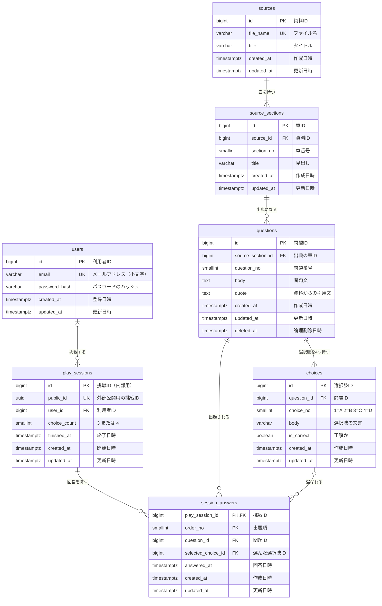

# ER図

各テーブルの詳しい定義は [db.md](db.md) を参照してください。

> 静的版（リポジトリ直下の `index.html`）は DB を使いません。Next.js 版（`api-server/`）はこの設計どおりのテーブルを Neon（PostgreSQL）に作り、Prisma で読み書きしています。
> この図は、そのテーブルの構造です。

## 読み方

| 記号 | 意味 |
| --- | --- |
| `\|\|--\|{` | 1 対 1以上（例：資料には章が1つ以上ある） |
| `\|\|--o{` | 1 対 0以上（例：まだ一度も出題されていない問題もある） |
| `\|o--o{` | 0か1 対 0以上（例：回答は未回答のあいだ選択肢を持たない） |

## まとめ

- **問題データ**（`sources` → `source_sections` → `questions` → `choices`）
  資料の章から問題を作り、1問に4つの選択肢をぶら下げます。4つ目は4択のときだけ使うダミーで、正解は必ず A〜C に置きます。
  出題をやめる問題は `deleted_at` で論理削除します。
- **プレイデータ**（`play_sessions` → `session_answers`）
  1回の挑戦ごとに、選んだ択数・シャッフル後の出題順・選んだ答えを記録します。
  正誤と正解数は記録せず、選んだ選択肢の `is_correct` から毎回求めます。
- `session_answers` の (`question_id`, `selected_choice_id`) は、`choices` の (`question_id`, `id`) への複合外部キーです。出題した問題の選択肢しか選べないことを DB が保証します。
